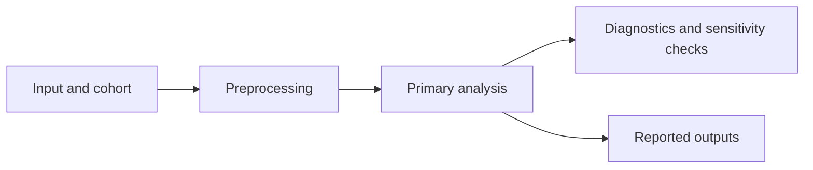

# Quarto scientific report template

A compact starting point for an evidence-led analysis report. Replace every
placeholder with information supported by the study record; remove sections that
do not apply.

## Front matter

```yaml
---
title: "Report title"
subtitle: "Question or cohort"
lang: en
format:
  html:
    toc: true
    toc-depth: 3
    code-fold: true
    code-summary: "Show analysis code"
    code-copy: true
    embed-resources: true
execute:
  echo: true
  warning: true
  message: false
---
```

`embed-resources` bundles linked scripts, styles, images, and video into the
HTML. It does not embed arbitrary data files for download. Keep warnings visible
until they have been reviewed. See the [Quarto HTML options](https://quarto.org/docs/reference/formats/html.html).

## Report structure

::: {.callout-note}
**Scope:** State whether this is exploratory analysis, model development,
internal validation, external validation, or application of a locked method.
:::

## Question and analysis unit

State the primary question, outcome or comparison, experimental unit, and the
population to which the result may apply.

## Data and cohort

| Input | Unit | Cohort or condition | Source and version |
|---|---|---|---|
| `[file or object]` | `[sample, patient, cell, ...]` | `[definition]` | `[recorded source]` |

Report the inclusion criteria, exclusions, denominator, and relevant missing
data. Do not infer sample counts from filenames.

## Workflow

Describe the steps that affect the primary result. Include preprocessing,
filtering, model formula, contrast direction, covariates, and software versions
when recorded.



Replace this diagram when the workflow branches; omit it for a simple linear
analysis.

## Results

Report the denominator and primary estimate first, with uncertainty where
available. Use a table for comparable estimates and a figure for patterns that
need visual inspection. Captions should name the population, measure, and
comparison; interpret results in the prose.

For Quarto cross-references, label figures `fig-...` and tables `tbl-...`, then
refer to them as `@fig-label` or `@tbl-label`. See the [cross-reference guide](https://quarto.org/docs/authoring/cross-references.html).

## Interpretation and limitations

Separate observed results from interpretation. State concrete threats to
inference, including confounding, repeated measures, cell-level pseudoreplication,
selection, class imbalance, missing validation, or limited generalizability when
they apply. Do not treat a non-significant result as equivalence or an association
as causation.

## Reproducibility

Record the software environment, reference data, code version, and output paths
needed to reproduce the analysis. Link to the analysis code and data access
conditions. Do not include restricted or identifying data in a public report.

## Optional references

Add a bibliography only when the referenced file exists and citations have been
verified. See [Quarto citations](https://quarto.org/docs/authoring/citations.html).
