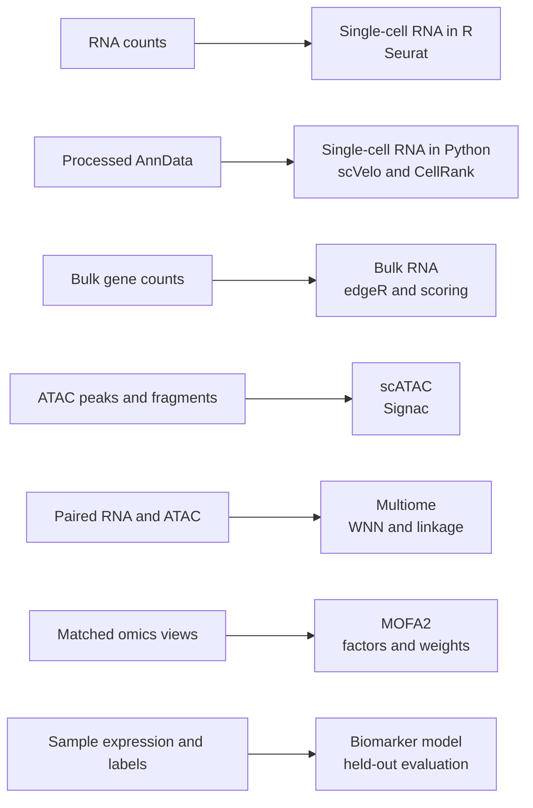

# Analysis guidebook

The active library is seven Quarto guides. Each guide keeps one main analysis
object and puts related steps in order. The original project notebooks under
`../code_MAP/` are preserved unchanged; these guides are the reusable starting
points.

## Guide map

| Guide | Main object | Analyses in one notebook |
|---|---|---|
| [Single-cell RNA in R](single_cell/guide_r.qmd) | `object` (Seurat) | QC, doublets, normalization, clustering, markers, scoring, trajectories, hdWGCNA |
| [Single-cell RNA in Python](single_cell/guide_python.qmd) | `adata` (AnnData) | scVelo, CellRank, decoupler, scCellFie |
| [Bulk RNA-seq](bulk_rna/guide.qmd) | `dge` (edgeR) | tximport, QC, differential expression, GSEA, singscore, GSVA |
| [scATAC-seq](scatac/guide.qmd) | `object` (Signac) | fragment QC, LSI, peaks, motif enrichment, chromVAR |
| [Multiome](multiome/guide.qmd) | `object` (Seurat) | paired QC, WNN, peak-gene links, label transfer |
| [Multi-omics with MOFA2](multiomics/mofa/guide.qmd) | `mofa` | matched views, fitting, factor diagnostics, weights |
| [Sample-level biomarkers](machine_learning/biomarkers/guide.qmd) | `model` | training-only preprocessing, bias-reduced classification, held-out reporting |

## Use

Run the code cells from top to bottom after changing the input paths and the
scientific choices for the study. Optional cells are marked in the guide.
The guides are drafts and have not been rendered or run on representative data.
Check the current package documentation, study design, and assumptions before
using results.

R objects use `.qs2`; AnnData objects use `.h5ad`; tables use TSV. MOFA2 models
use their native HDF5 format.
